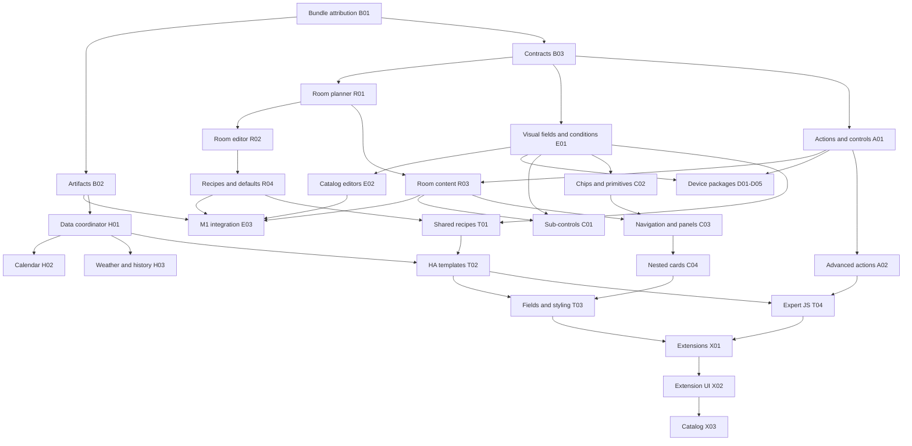

# Competitive implementation plan

Status: **implementation in progress**, started 20 October 2026. See the [implementation progress and remaining acceptance](implementation-progress.md) for delivered slices, bundle measurements and next work. This is the execution plan for the [competitive audit](../audits/2026-10-20-navet-cards-competitive-audit.md), using the [versioned competitor evidence](../audits/2026-10-20-competitor-evidence.md).

## 1. Objective and scope

Build Navet Cards into a practical alternative to **Bubble Card 3.4.2**, **Mushroom 5.2.3**, and **button-card 7.0.1**. Start with sustainable packaging and a complete room setup without YAML, then deliver broad device controls, composition, data, reusable configuration, programmable presentation and extensions.

The objective is functional coverage and a compelling Navet experience. Exact competitor YAML syntax, pixel-for-pixel reproduction, every community module, paid extensions, community size and third-party acceptance are not implied by functional parity. All major capability categories identified in the audit have work packages below. Later priorities remain part of the plan; they are not quietly discarded to reach an early milestone.

Work should continue through independent packages as capacity permits. Time spent is not a completion criterion. Each completed package needs integrated behavior and evidence; scaffolding, a picker entry or a simulated screenshot alone is insufficient. Revisit source evidence when implementing a specific competitor feature, particularly where stable documentation may have advanced beyond the pinned release.

The baseline is Navet `0.1.0-beta.3`, checkout `746181623facd3d08085b77e0d5f0ec9d2b698da`, tree-equivalent to main `a145c37ccc49c3c2336d5db3c6fdab3c747ecaad`. Existing evidence: 26 contract tests, 5 release tests, 46 browser tests; resource 139,964 raw / 39,494 gzip bytes. These are baseline observations, not future guarantees.

## 2. Priorities and completion milestones

| Priority | Milestone | Required outcome |
| --- | --- | --- |
| P0 | M0 — Room to build | Measured bundle attribution, growth measurements, supported artifact topology, compatible configuration evolution and independent module ownership |
| P1 | M1 — Complete room without YAML | Choose an area, select/reorder devices, configure useful controls and conditions, preview, save, reopen and operate a room entirely visually |
| P1 | M2 — Competitive household controls | Rich device controls, compact sub-controls/chips, accessible touch/keyboard operation, sensible state display and visual editing |
| P2 | M3 — Competitive dashboard composition | Configurable room content, nested cards, popup/navigation behavior, reusable recipes and complete data-card lifecycle |
| P2 | M4 — Broad library coverage | Remaining mainstream domains, calendar, history, badges, titles, layouts and a generic configurable card |
| P3 | M5 — Programmable customization | HA templates, inherited configuration, JavaScript customization, custom fields/styles and advanced actions |
| P3 | M6 — Extension ecosystem | Versioned extensions, visual extension configuration, import/export, updates and a supported catalog |
| Continuous | M7 — Release confidence | Candidate-specific compatibility, HACS lifecycle, device evidence, coexistence and clear migration/release documentation |

Milestones overlap where their dependencies allow it. M7 begins with packaging and continues throughout; household acceptance does not prevent independent engineering packages from proceeding. General Bubble replacement claims require M3/M5 evidence, not just M1. A programmable library claim requires M5; an ecosystem claim requires M6 plus actual supported extensions.

### Current checkpoint and remaining implementation

Updated 20 October 2026 after integration of pinned competitor child coexistence, service-only momentary actions/temporary protection, Calendar, scoped reusable configurations and HA/Jinja display templates. The linked [progress ledger](implementation-progress.md) owns exact delivered behavior, candidate hashes, verification and remaining acceptance; this section sets execution priorities.

| Milestone | Current implementation position | Work to finish |
| --- | --- | --- |
| M0 | Bundle reports, two artifact profiles and configuration contracts implemented | Installation/upgrade/rollback acceptance; standalone stays the supported default |
| M1 | Complete visual room journey implemented and automated/native frontend slices verified | First-time-user/household acceptance, recipe breadth and remaining editor options |
| M2 | Mainstream device controls and advanced action slices largely implemented | Alarm/lock code flows, remaining light modes, media/remote depth, PIN/feedback/haptics and control variants |
| M3 | Popup/navigation, arbitrary children and scoped configuration reuse implemented | Remaining mobile/sidebar options, broader third-party behavior and acceptance |
| M4 | Calendar and core content implemented | Native/template badges, richer weather/history, ordered attributes/timestamps, remaining domain recipes and generic configurable presentation |
| M5 | Initial T01 reusable configurations and T02 HA display templates implemented | Wider template field coverage; T03 custom fields/layout/styles; T04 expert JavaScript templates/actions |
| M6 | Not implemented | X01 versioned extension host, X02 lifecycle/configuration UI, X03 catalog and supported examples |
| M7 | Automated checks, packaging and bounded actual-HA evidence in place | Complete localization/accessibility, named physical clients, minimum-version remaining features, HACS lifecycle and maintainer acceptance |

The engineering estimate is **35–45% of implementation effort remaining**, with release/device acceptance tracked separately. This is a planning estimate based on scope and complexity, not a measured completion percentage, package-count ratio or delivery-time commitment. Large unstarted customization/extension packages carry more effort than individual remaining controls. Preserve every original package and coverage row below until implemented or an explicit reviewed difference is recorded.

## 3. Initial design decisions

1. **Keep existing card types and configuration working.** Validate and normalize old inputs into an internal model. Visual editing emits intentional configuration changes through HA's `config-changed` flow. Do not rewrite saved dashboards on render or fetch.
2. **Keep Home Assistant in control.** Reuse its supplied state, authentication, registry and action interfaces. Do not create another login/socket, alter global themes/settings, or write whole dashboards behind the editor's back.
3. **Use deep modules at real seams.** Put reusable behavior behind small interfaces: configuration normalization, room planning, command/control descriptions, requests, actions and panel lifecycle. Keep raw HA payloads and translations in provider modules. HA and the simulated host are the first real adapters.
4. **Extract when delivering behavior.** Do not spend the first wave mechanically splitting every renderer. Move a responsibility out of `NavetCard` when its first new feature needs that seam. Existing unaffected families keep working.
5. **Treat visual authoring as part of each feature.** New mainstream configuration is incomplete without an editor, preview, validation, keyboard operation, saved round-trip and documentation. An expert code editor is acceptable for JavaScript/CSS; ordinary room setup never requires it.
6. **Use explicit configuration scopes for reuse.** A later Navet composition root may own shared definitions for its descendants. Standalone cards remain self-contained. Do not depend on undisclosed access to arbitrary dashboard-wide configuration or store authoritative definitions only in browser storage.
7. **Separate broad functionality from imported compatibility.** Native Navet equivalents ship first. Import assistants identify unsupported behavior and preserve the source. They never silently claim to execute all competitor configuration.
8. **Keep the breadth commitment.** Declarative configuration comes before executable customization, but both are planned. Extensions come after their lifecycle and distribution interfaces are proven.

## 4. Bundle and distribution plan — first work

### The problem to solve

At the original audit baseline, the resource had only 36 raw bytes of headroom under its then-current size limit. Size ceilings have since been removed at the user's request. At that baseline, `index.ts` imported the editor eagerly and CSS/all families shared one resource. Moving an import inside a function does not reduce transfer size when the bundler still emits one file. Packaging, release evidence and HA validation then assumed one `navet-cards.js` file; current implementation status is recorded in the progress ledger.

### Work sequence and decision rule

**B01 first:** generate esbuild attribution and compare two real builds: a maintained standalone bundle and an ESM build with an editor chunk. Include the CSS transform, Lit sharing, legal comments and production minification. Measure entry bytes, total bytes, gzip per actual file, evaluated code and requests for view/edit/open-room scenarios. Separate source organization improvements from actual byte savings.

**B02 next:** implement matching build profiles and verification. Keep standalone installation supported. Prefer a modular default for the expanded library only after the full asset lifecycle is demonstrated. Initially split editor code; later isolate data-heavy and expert/extension features. Common everyday controls must not cause one network request per card. Avoid duplicate Lit copies and repeated custom-element registration.

The modular profile must resolve chunks relative to the loaded module, including `/local/`, `/hacsfiles/`, reverse-proxy prefixes and preview paths. Release builds must use immutable version/content-hashed chunks. Cache refresh, an old open tab during upgrade, missing chunks, failed imports, retry and rollback have explicit behavior. A query parameter on the entry does not automatically version every imported URL.

HACS documentation describes downloading matching JavaScript assets, but the current `filename` manifest and actual installation behavior must be verified with the chosen layout. Do not assume that publishing a ZIP distributes every imported file. [HACS Dashboard requirements](https://www.hacs.xyz/docs/publish/plugin/)

If HACS/device acceptance for a modular default is unavailable, continue implementing with the standalone profile and retain modular output as an evaluated candidate. Do not hold all feature engineering for that external dependency, and do not advertise unverified modular installation.

### Measurement policy — ceilings deferred

The user has removed all bundle size ceilings and will consider limits later. Keep raw/gzip sizes, source attribution, full installed size, actual initial/static closures and optional-feature increments visible in every build. Use decimal bytes and consistent per-file gzip settings. There are no working targets, hard limits or size-based build failures in the current policy. Do not count an isolated tiny entry as the initial dependency closure.

**M0 bundle exit:** a clean lockfile build, reproducible manifest containing each file's digest, no CDN dependency, supported standalone output and verified modular path/upgrade behavior in simulation and disposable HA. HACS promotion remains conditional on real installation evidence. Future ceilings require a separate measured decision.

## 5. M1 product specification — a complete room without YAML

### The user journey

1. Add **Navet Room** in HA. The editor offers **Create from area**, **Choose devices**, and named examples; it does not preselect unrelated first-three lights.
2. Choose an area by friendly name. See suggested entities grouped as lighting, comfort, media, readings and actions. Hidden/disabled/diagnostic entries stay excluded by default. Explain missing registry access and offer explicit selection.
3. Choose live area membership or an explicit snapshot. Preview which devices will follow future area changes; include/exclude overrides are visible and reversible. The legacy explicit-list precedence remains unchanged for old cards.
4. Pick a room recipe: everyday room, lighting, comfort, media, or entry. Roles use capabilities and device class, not names alone. Ambiguous sensors require a visible choice; no arbitrary “first sensor is temperature” assumption.
5. Reorder and label sections/devices using pointer and keyboard buttons. Select overview readings and primary controls. Add an action, navigation link and up to the existing supported limit of secondary controls. Increase limits only with layout/performance evidence.
6. Configure a conditional secondary control through an entity/operator/value editor. Choose name, icon, appearance, control visibility, layout, density and the primary/icon gestures exposed at this milestone.
7. Preview the actual room in the HA editor. Show the summary and dialog; preview gestures never send device commands or navigate the real dashboard. Loading, unavailable, missing and error examples are available in the simulated demo.
8. Save through HA. Reopen, edit one field and save: ordering, conditions, advanced YAML and foreign fields survive. Reload the page and operate the real room.
9. Duplicate/export the recipe as a configuration snapshot, visually remap devices to another room, preview and save. Later shared templates add live reuse; M1 does not pretend snapshot copies update together.

The wizard configures the selected room card and its native content. It does not silently create multiple HA cards, change dashboard layout, add helpers, or alter entity registries. Users can place the room in Sections or Masonry normally. A later composition root can visually manage multiple nested cards.

### Required M1 room content

- Overview readings with units and meaningful unavailable states; optional occupancy/presence summary.
- Supported light on/off/brightness, switch, climate target/mode, speaker transport/volume, number and select controls using existing normalized commands.
- Explicit action buttons and room navigation; useful compact density rather than large mostly empty action tiles.
- Lazy room sections; closed rooms retain no detail controls or data subscriptions.
- No automatic scene/script execution from recipe selection, preview, saving or membership changes.
- Entity details remain accessible for advanced settings. Missing RGB, tilt and range controls are identified as later work, not counted as M1 parity.

### Acceptance scenario

Use a kitchen with two lights, motion, temperature/humidity, a speaker, a numeric helper and a scene. Start with a fresh dashboard and no copied YAML. Create the room, exclude one device, choose temperature/occupancy roles, reorder, set one condition, configure a scene action and room link, change appearance, preview and save. Operate existing supported controls. Reopen/edit/save/reload; remove an entity and change an area assignment; verify the declared membership policy. Repeat with no registry access, long Swedish labels and unavailable entities.

**Automated exit:** the full scenario is exercised through the actual editor, with serialization, cancellation, read-only preview and advanced-field preservation. Screenshots at 390/768/1280 px show every new editor state and runtime composition. Existing room-performance guarantees remain intact.

**Observed usability target:** at least three first-time users complete the advertised scenario without YAML or developer help. Aim for a useful first room within five minutes, excluding installation and device discovery. This is a proposed target; record actual results and compare the same task with pinned alternatives. Engineering completion and observed usability acceptance are reported separately.

## 6. Modules and interfaces to establish

Paths are intended ownership locations; the first contract package finalizes names. Do not invent a generalized framework before the first callers exist.

| Module / proposed location | Small interface and responsibility | Important invariants |
| --- | --- | --- |
| Configuration — `src/config/` | Validate/normalize/serialize supported configuration; report structured field errors and version compatibility | Pure, cloned inputs; preserve unknown saved fields; idempotent normalization; no silent destructive migration |
| Room planner — `src/rooms/` | `planRoom(draft, catalog)` returns sections, capabilities, membership policy, dependencies and diagnostics | Deterministic IDs/order; explicit role ambiguity; no host side effects |
| HA catalog adapter — `src/providers/` | Derive room candidates and localized normalized entity/control descriptions from HA | Raw registry/features stay here; shared registry index preserved |
| Controls — `src/controls/` | Render normalized control descriptions and emit typed intent | No direct HA payload access; command owner, availability, range and step rechecked at dispatch |
| Actions — `src/actions/` | Resolve/run one configured action or sequence with lifecycle context | Consistent gestures, confirmation, busy/error handling, cancellation and preview policy |
| Conditions — `src/conditions/` | Compile declarative conditions to evaluator + dependency set | Bounded depth; typed values; unavailable/missing defined; no executable expressions in declarative mode |
| Room/panel lifecycle — `src/panels/` | Open/update/close/dispose room content and coordinate navigation/focus | One intended active panel per scope; no retained closed detail work; preview isolation |
| Data coordinator — `src/data/` | Observe a typed query with snapshot states and a release handle | Share in-flight work by host/query; pause by visibility; ignore obsolete responses; cancel where transport permits |
| Recipe resolver — `src/recipes/` | Resolve named definitions + parameters + local overrides to normalized configuration | Cycle detection, deterministic merge, source provenance, migration and export |
| Editors — `src/editor/` | Controlled drafts, field errors and `config-changed` emission | Cancel is lossless; stable item IDs; no service calls; same schema as runtime |
| Customization — `src/customization/` | Resolve display/style fields and report dependencies/diagnostics | Declarative, HA template and expert JS modes explicit; failures isolated per field/card |
| Extension host — `src/extensions/` | Load compatible extension, configure, mount/update/dispose | Version pin, feature declaration, cleanup, no duplicate registration; not a sandbox claim |

Room/editor/renderer callers share `RoomPlan`; they do not independently rediscover area rules. Capability-specific renderers share control descriptions rather than reimplementing limits or HA feature bits. New seams must replace duplicated responsibilities, not wrap the old class with pass-through layers.

### Configuration and migration rules

- Introduce a version marker for new structured configuration while continuing to accept unversioned existing cards. Record supported input versions separately from emitted version.
- Preserve old `area`/`entities`, `panel_id`, appearance, actions and sub-controls exactly unless explicitly edited. Define new membership semantics without changing old precedence.
- Stable IDs identify sections, controls and rules across reorder. Merge keyed lists by ID; default ordinary arrays to replacement. Document deletion, inheritance, null and absent values. Never combine action targets/data by an accidental generic deep merge.
- A serializer updates only fields owned by that editor and carries through unrelated fields. Keep the original input and an explicit migrated draft until Save.
- Unknown future configuration versions show a useful error and permit source recovery/export. Do not “repair” them by dropping fields.
- Downgrade support is versioned: preserve the pre-migration export and document when new configuration needs a newer runtime. Rollback of the resource alone cannot erase new features from saved configuration.

## 7. Competitor capability coverage ledger

The rows below are planned Navet deliverables, not claims that every competitor has every listed feature. B/M/C identify the relevant Bubble/Mushroom/button-card capability category. Source details live in the audit/evidence; recheck exact stable-tag behavior during each package.

| Coverage ID | Offering to deliver | Reference category | Work packages |
| --- | --- | --- | --- |
| F01 | Capability-aware picker recipes and room setup | B/M | R01–R04, E01 |
| F02 | Full visual configuration, icon/color pickers, layouts and preserved YAML | M/B | E01–E03, Q01 |
| F03 | Standalone sub-controls, chips, groups, badges and conditions | B/M | C01, C02, T01 |
| F04 | Horizontal navigation, fixed footer, active state, app/back links | B/M | C02, C03 |
| F05 | Popup content, sizes, mobile modes, triggers, close/timeout/swipe | B | C03, C04 |
| F06 | Arbitrary nested cards and child editors | B/C | C04, T03 |
| F07 | Titles, separators, empty spacing and presentation layouts | B/M/C | C02, T03 |
| F08 | Light color, brightness, Kelvin, effects and state-derived colors | B/M/C | D01, T02 |
| F09 | Climate target ranges, modes/presets and comfort domains | B/M | D02, D04 |
| F10 | Covers including tilt and capability-specific control visibility | B/M | D02 |
| F11 | Fans: percentage, presets, oscillation and direction | B/M | D03 |
| F12 | Media transport, seek, power, source, volume, mute and grouping where supported | B/M | D03 |
| F13 | Vacuum speed/transport, remote activities and generic domain recipes | B/M | D03, D05 |
| F14 | Alarm mode/keypad, lock/code flows and update entities | B/M | D04, D05 |
| F15 | Generic entities, ordered state/attribute content, timestamp display and pictures | B/M/C | D05, T02, Q01 |
| F16 | Calendar with event details, filters, date windows and actions | B | H02 |
| F17 | Weather/history and native data presentation with complete request lifecycle | Navet breadth | H01, H03 |
| F18 | Notes/photos/grouped readings and media-stack editing | Preserve Navet strengths | E02, H03 |
| F19 | HA/Jinja templates for display, icons, color and conditions | B/M | T02 |
| F20 | Inherited named configurations, variables, overrides and shared application | B/C | T01 |
| F21 | State rules, CSS Grid/custom fields, dimensions/aspect ratio, animations | C/B | T03 |
| F22 | Card/icon tap/hold/double-tap, momentary press/release and repeat | C/M/B | A01, A02 |
| F23 | Service, URL, Assist, event, navigation, multi-step, toast and JS actions | C/B | A01, A02, T04 |
| F24 | Confirmation, UI action locks/PIN, feedback, busy state and haptics | C/B | A02, Q01 |
| F25 | JavaScript field templates/helpers and dependency/update controls | C/B | T04 |
| F26 | Extension hooks, visual forms, module application/import/export/update | B | X01, X02 |
| F27 | Supported catalog and reusable community recipes | B ecosystem | X03, P01 |
| F28 | HACS/manual lifecycle, documentation, compatibility and migrations | All | B02, P01, Q02, Q03 |

This ledger must remain traceable to executable acceptance examples. A row becomes **verified** only for the implemented subset and evidence level recorded. No aggregate “100% parity” score is inferred from checked rows. A marketplace mechanism does not recreate an existing community's module inventory.

## 8. Work packages

Dependencies below refer to package IDs, not whole milestones. A package may be implemented on its predecessor's integrated branch once its interface is stable. Each package includes its editor/schema/docs changes unless a named companion package owns them. Split oversized packages into numbered child slices before dispatch; preserve the acceptance and coverage IDs.

### M0: packaging and contracts

**B01 — Bundle attribution and measurement reports.** Depends: none. Own `scripts/build.mjs`, a new measurement/report module and focused build checks. Produce the current standalone baseline, esbuild metafile report, two-profile experiment and dependency-closure metrics. Inspect CSS transform correctness and legal notices. Add CI size output with actionable module contributions. **Done:** reproducible clean-build metrics, a recorded topology decision and scenario measurements; no behavior change required. Size: small/medium.

**B02 — Complete artifact topology.** Depends: B01. Own packaging/release/preview/validation scripts and manifest changes. Produce standalone and modular artifacts, relative immutable chunk loading, all-file checksums, missing/import-failure behavior, complete preview assets, downloaded-release verification and version metadata. Keep standalone fallback available until modular installation is accepted. **Done:** both profiles run from extracted assets in simulated and disposable HA hosts; upgrade/old-tab/rollback checks pass; HACS evidence recorded separately. Size: large; split build/load and publish/install slices.

**B03 — Configuration evolution and module contracts.** Depends: B01. Own `src/config.ts`, `src/core.ts` and initial `config/` definitions. Specify normalized room plans, control intents, membership/rule/action IDs, schema versions, serialization and structured diagnostics. Establish old-fixture round-trip coverage and the minimal interfaces consumed by R01/R02/A01. **Done:** legacy saved cards render unchanged; new draft normalization is deterministic; no global mutation; contracts small enough for independent implementers. Size: medium.

### M1: room and visual setup

**R01 — Room catalog and planner.** Depends: B03. Own `src/rooms/`, HA room-catalog adapter and focused provider tests. Resolve area/device overrides, explicit membership, include/exclude choices, device-class roles, stable sections and capability-aware recipes. Reuse the registry index. **Done:** kitchen/comfort/media/entry plans are deterministic, ambiguous roles diagnosed, registry invalidation correct, unrelated updates remain inexpensive. Size: medium.

**R02 — Room editor journey.** Depends: B03, R01. Own `src/editor/room-*`. Implement the nine-step journey in section 5 as a compact progressive editor, not nine mandatory screens. Provide membership preview, recipe selection, ordering, roles and save/cancel. **Done:** complete kitchen scenario is authored without YAML; reopening preserves all fields; fallback for missing registry access is usable. Size: large; split membership/recipe and sections/preview slices.

**R03 — Structured native room content.** Depends: R01, A01. Own `src/panels/room-*` and native room renderers. Consume `RoomPlan`; render chosen readings, devices/actions and sections; lazily mount/unmount controls; preserve existing hashes/focus. **Done:** editor and runtime show the same selection/order; correct owning commands; empty/unavailable sections work; no closed detail work. Size: medium/large.

**R04 — Room recipe duplication and picker defaults.** Depends: R01, R02. Own `src/recipes/builtin-*` and suggestion contributors; integrator wires `index.ts`. Add sensible entity recipes, room examples, snapshot export/import and visual entity remapping. **Done:** second-room remap is visual, source is unchanged, missing roles are explicit and examples never issue commands. Size: medium.

**E01 — Shared visual fields and conditions.** Depends: B03. Own `src/editor/fields-*`, `src/conditions/`. Native entity/area/action/icon/color fields; bounded all/any/not rules with state, attribute, numeric and availability comparisons; stable list editing and dependency extraction. **Done:** field errors are local, invalid drafts do not corrupt saved config, conditions have defined missing/unknown behavior, unrelated state updates do not re-evaluate every card. Size: large; first deliver M1's entity-state/availability subset, then expand in C01/T01.

**E02 — Complete current-catalog authoring.** Depends: E01. Own grouped/gallery/sub-control editors. Replace grouped textareas with ordered multi-select; add photo lists/alt text; note sources; primary/secondary energy roles; UPS role choice; player lists; conditional sub-control actions and appearance previews. **Done:** every existing mainstream option has a visual path, advanced fields survive, helper-backed notes retain privacy and length behavior. Size: medium/large, separable by editor family.

**E03 — Integration of the room editor and preview.** Depends: R02, R03, R04, E01, E02, B02's usable profile. Own editor composition and M1 end-to-end fixtures. Wire progressive sections, read-only preview, loading/error states and documentation. **Done:** section 5 acceptance passes at all target widths, old editor tests remain valid, and bundle size and dependency closures are reported. Size: medium; root/integrator package.

### M2: actions, controls and device depth

**A01 — Shared action and control execution.** Depends: B03. Own `src/actions/`, first `src/controls/` interfaces; root wires the card. Preserve existing gesture behavior, confirmations, preview restrictions, busy/error lifecycle and owning-entity validation. Add separate configurable icon gestures and an explicit distinction between card action and direct control. **Done:** old actions still behave identically; one gesture dispatches once; reconnect/disconnect/config changes cannot dispatch stale intents. Size: medium.

**A02 — Advanced actions and interaction feedback.** Depends: A01. Add external URL, back/replace navigation, Assist and host events through supported HA interfaces; explicit action sequences, toast feedback, momentary press/release, repeat and cancellation. Add UI lock/PIN flow, optional haptics respecting HA preferences and accessible confirmation. Expert JS action execution belongs to T04. **Done:** cancellation and pointer loss terminate repeats/release state; sequence error/continue rules are explicit; no preview dispatch; UI PIN is described as accidental-action protection, never backend authorization. Size: large; split actions/sequences and gestures/protection.

**D01 — Advanced lights.** Depends: B03, A01, E01. Own light provider/control/editor files. Add supported color modes, native color conversion/limits, effect selection, white/Kelvin behavior and entity-derived visual colors. Avoid sending unsupported parameters together. **Done:** binary/dimmable/color/Kelvin/RGBW combinations retain valid controls; zero/off/current-state behavior is correct; service payloads and physical-device outcomes are recorded. Size: medium/large.

**D02 — Climate ranges and cover tilt.** Depends: B03, A01, E01. Separate climate/cover child slices. Add dual setpoints with unit/step/invariant checks, presets/fan/swing where advertised, and tilt position/open/stop/close. **Done:** crossing targets, Fahrenheit, missing positions and partial feature combinations work; controls/editors remain contained; provider round trips verified for available devices. Size: large.

**D03 — Media, fan, vacuum and remote depth.** Depends: B03, A01, E01. Split by domain before dispatch. Add media seek/time progression and supported power/repeat/shuffle/group actions; fan presets/oscillation/direction; vacuum advertised speeds and transport variants; remote activity selection. **Done:** each intent uses the selected owner and current advertised options; progress does not create unnecessary global renders; unsupported groups/actions stay absent. Size: large, several independent domain packages after shared contracts.

**D04 — Comfort and security domains.** Depends: B03, A01, A02's protection interface, E01. Separate humidifier/water-heater and alarm/lock slices. Add native capability models, appropriate modes/targets, alarm arming/disarming and code-required flows; improve protected-lock handoff or native code entry. **Done:** codes are transient and absent from saved config/logs/exports; failures preserve useful retry state without exposing secrets; supported modes come from HA; real permissions remain enforced by HA. Size: large.

**D05 — Generic domain recipes and update entities.** Depends: R04, A01, E01. Preserve generic entity, number/select/person/scene/script behavior; add ordered state/attributes, timestamp information and update details/actions. Build a checked domain recipe table including less common HA domains from the pinned competitor baseline; do not count domain names as dedicated implementations. **Done:** every recipe lists supported tasks, capability requirements, editor and fallback; an update never starts merely from opening details. Size: medium/large.

### M3/M4: composition and content

**C01 — Rich sub-controls.** Depends: E01, A01, R03. Add independent sub-control card, icon/name/state/attribute options, button/slider/dropdown variants, grouping, top/bottom placement, read-only/hold-to-slide behavior and conditions. **Done:** main and sub-control gestures do not conflict; slider cancellation/scrolling work; state/range/options stay current; closed groups do not retain unnecessary work. Size: large.

**C02 — Chips, badges and layout primitives.** Depends: E01, A01. Add compact action/entity/template/weather/navigation chips; conditional chips; title/subtitle, separator and meaningful spacing options; native template/status badges via HA's supported registration when available. **Done:** visual editor covers options; narrow rows wrap or scroll deliberately; badging and empty-space behavior are accessible; older HA gets documented fallback. Size: medium/large.

**C03 — Navigation and popup coordinator.** Depends: R03, C02, A01. Add active navigation, sticky/fixed footer with safe-area/sidebar offsets, back semantics, unique scope/panel IDs, popup sizes/styles, state triggers, timeout, swipe and foreground/reconnect reconciliation. **Done:** one intended active panel, browser back and native more-info coexistence; manual dismissal does not immediately reopen from a stale trigger; repeated attach/detach leaves no global listeners or timers. Size: large.

**C04 — Arbitrary child cards and composition editor.** Depends: C03, B03. Use HA helpers behind a child-card host module. Add nested card selection/configuration, reorder, Sections/Masonry sizing and per-child errors. Pass host/preview/edit state correctly; mount only active content; preserve foreign configurations. **Done:** native Tile/history/calendar plus pinned Bubble/Mushroom/button-card examples work in disposable HA; failed/missing child card does not break the room; focus and details overlays coexist. Document unsupported third-party behavior explicitly. Size: large; first native children, then custom children/editor integration.

**H01 — Shared data coordinator.** Depends: B03, B02. Own `src/data/` and HA query adapters. Migrate weather/history to typed observe/release snapshots; host/query deduplication, freshness, visibility, retries, reconnect and bounded intervals/point counts. Distinguish unsupported/loading/empty/denied/offline/error/stale. **Done:** two equivalent cards share work, stale generations cannot paint, release ends subscriptions/timers, transports without abort support still discard obsolete results. Size: medium/large.

**H02 — Calendar.** Depends: H01, E01, A01. Multi-calendar agenda/date window, all-day/timezone/DST handling, filtering/limits, event actions, supported native event details and live invalidation. **Done:** same-time events, ongoing/all-day events, edits/deletes, empty/denied/offline states and keyboard event access work; fetching stops when unused. Size: large; event creation/editing is a separately justified later slice, not assumed part of read-only parity.

**H03 — Weather/history and existing rich content.** Depends: H01, E02. Add supported daily/hourly weather choices, numeric history/sparklines with explicit units/ranges/downsampling, and consistent photo/media loading states. Preserve notes, gallery, batteries and UPS strengths. **Done:** no synthetic history substituted for real values; gaps and unavailable intervals are honest; duplicate content shares queries; metadata, alt text and long labels remain useful. Size: large, separable query/render slices.

### M5: reuse and programmable customization

**T01 — Named recipes, inherited configuration and scope.** Depends: B03, E01, R04. Add explicit local definition libraries and a Navet composition root for shared descendant configuration; variables, ordered multiple inheritance, keyed overrides, cycles/depth limits and visual import/export/remapping. Ordinary standalone cards can materialize shared recipes. **Done:** one shared change updates intended descendants only; detached copies stay independent; deleting/missing definitions is recoverable; no undocumented global registry or arbitrary HA dashboard mutation. Size: large.

**T02 — Display fields and HA templates.** Depends: T01, H01, D05. Names/state/attributes/icons/pictures/colors/badges and conditional display gain normalized value sources and HA/Jinja support. Verify the supported HA subscription/renderer interface on minimum/current targets; own unsubscribe and dependency updates. **Done:** errors are visible per field, unavailable entities and locale are correct, multiple equivalent subscriptions are shared where possible, disconnect/reconnect cleanup works and templates do not cause render/service loops. Size: large.

**T03 — Configurable card, custom fields and scoped styling.** Depends: T01, T02, C04. Add a generic configurable card with named display fields, CSS Grid/positioning, dimensions/aspect ratio, icon/card coloring, state rules, optional scoped CSS, animations, hover/ripple/spinner and embedded child cards. Expose stable style tokens/parts and a visual basic-layout editor. **Done:** scoped customization never mutates global theme styles; fields have contained errors; reduced motion and high-contrast behavior remain usable; supported layout examples fit HA sizing. Size: large; ship layout/fields before arbitrary style code.

**T04 — Expert JavaScript templates/actions.** Depends: T01, T02, A02. Add explicit opt-in code fields, variables/helpers, asynchronous/error semantics, entity dependency declarations and refresh policies. Support templated action objects via the same validated action module. Keep rendering pure; actions execute only from explicit action paths. **Done:** dependency changes update correctly, syntax/runtime failures stay local, lifecycle cancels asynchronous continuations, preview blocks side effects from the supported action interface, diagnostics identify expensive work. Size: large.

JavaScript running in the HA page is trusted code with page privileges. An interface wrapper does not sandbox it; synchronous infinite loops cannot reliably be interrupted on the main thread. Do not promise hard execution limits or preview isolation for arbitrary malicious code. Evaluate a worker only for serializable pure computation; DOM/HA-page customization remains an explicitly trusted mode. Do not include remote code automatically merely because a recipe references a URL. [button-card JavaScript model](https://custom-cards.github.io/button-card/stable/advanced/js-templates/)

### M6: extensions and adoption

**X01 — Versioned extension host.** Depends: B02, T01, T03, T04. Define extension metadata, compatibility, configuration schema, normalized inputs, render/action hooks, update tracking and disposal. Implement two real in-repo extensions first to validate the interface. **Done:** register/load/mount/update/dispose is demonstrable; duplicate/incompatible extensions fail usefully; a lifecycle test catches retained subscriptions; no unsupported sandbox/security claims. Size: large.

**X02 — Extension authoring and lifecycle UI.** Depends: X01, E01. Add configure/preview, import/export, enable/disable, scoped shared application, pinned versions, update preview and rollback. Store references/configuration in HA-owned card/composition config. **Done:** imports preserve unknown settings and show incompatibilities; disabling releases work; updates do not mutate saved configuration without Save; old versions remain recoverable. Size: large.

**X03 — Catalog and contributor path.** Depends: X02, P01. Ship a curated manifest/catalog with maintained example recipes/extensions, docs, compatibility policy and local install/update workflow. Network-based catalog delivery is optional transport, not required for installed cards to render. **Done:** stale/offline catalogs do not break installed cards, version pinning works, contributions have a clear supported interface and test fixture. External hosting/publication requires the applicable maintainer authorization. Size: medium/large plus continuing maintenance.

**P01 — Migration and documentation for adoption.** Depends: R04; expand with T01/X02. Provide task cookbook, actual install files, troubleshooting, release notes and import reports. Start migration assistants with simple Bubble/Mushroom/button-card configurations; map entities/actions/layouts where semantics match and list unsupported fields. **Done:** source configs remain intact, preview differences visible, no “converted” success when behavior was dropped; native Navet recipes require no competitor dependency. Size: medium initially, continuing per coverage row.

### Continuous quality and release work

**Q01 — Accessibility, localization and visual consistency.** Depends: E01/A01 for first slice; follow every feature. Use HA locale/state formatting, translate editor strings, verify English/Swedish and extensible translation keys. Review touch targets, keyboard/focus, screen-reader names/status, contrast, large text, reduced motion, compact density and information hierarchy. **Done:** automated accessibility checks plus human keyboard/screen-reader/touch evidence on declared scenarios; no claim of compliance from screenshots alone. Target 44 px comfortable touch hit areas while preserving an explicit dense choice; measure layout effects. Size: recurring bounded slices.

**Q02 — Performance and soak evidence.** Depends: B01; expand after R03/C04/H01/T04. Preserve existing synthetic gates; add relevant-update bursts, duplicate queries, hidden views, artwork, editor opening, 100 panel cycles, reconnects and bounded long-session tests. Compare equivalent tasks on named older tablet, phone and kiosk clients. **Done:** record device/browser/HA/build/dataset, cold/warm paths, interaction P50/P95, long tasks/frames and heap/listeners after recovery. No unexplained growth or lost controls. Desktop emulation is not device acceptance. Size: recurring bounded slices.

**Q03 — Compatibility, distribution and release acceptance.** Depends: B02 for first slice; every candidate thereafter. Cover supported minimum HA plus current stable selected at execution, rendered editors, native details, non-admin users, denied services, reconnect, Sections/Masonry, native/Bubble/Mushroom/button-card coexistence, manual/HACS install/update/rollback and companion apps. **Done:** candidate-specific live checklist/evidence, documented limits and explicit maintainer authorization for publication. HACS default listing and community adoption remain external outcomes. Size: engineering plus device/maintainer dependencies.

## 9. Dependency graph and parallel execution

The graph summarizes the critical paths; package dependency paragraphs are authoritative for omitted edges. Quality/distribution slices run alongside feature waves. No agent starts code against an interface another agent is still freely redesigning.

### Dispatch waves with the current four-slot capacity

One root/integrator plus at most three active workers. No background monitoring agents. A package can use more waves when its bounded child slices warrant it; do not create a giant all-features assignment.

| Wave | Worker A | Worker B | Worker C | Root/integrator |
| --- | --- | --- | --- | --- |
| 0 | B01 bundle report/build experiment | B03 legacy/config contract proposal | Q02 baseline fixtures/measurement proposal | Freeze public interfaces, review artifacts; land B01 before choosing later size limits |
| 1 | B02 build/package slice | R01 room planner | E01 field/condition slice | Implement/integrate A01 and reserve central files |
| 2 | R02 membership/recipe editor | R03 native room content | E02 grouped/gallery authoring | Finish B02 integration and inspect room/UI evidence |
| 3 | R02 section/preview completion | R04 recipe duplication/picker | E02 sub-control authoring + Q01 slice | E03 integrate complete M1 scenario and bundle report |
| 4 | D01 lights | D02 climate then cover | C01 sub-controls | Integrate; Q03 candidate fixtures and A02 actions |
| 5 | D03 media/fan child slices | D04 comfort/security child slices | C02 chips then C03 navigation | Integrate shared changes; Q01/Q02 affected evidence |
| 6 | H01 data then H02 calendar | C04 child host/editor | D05 remaining recipes | T01 recipe scope/resolver; P01 migration/docs slice |
| 7 | H03 data presentation | T02 display/HA template slice | T03 layout/custom fields after dependencies | Integrate T01/T02 contracts, Q03 evidence |
| 8 | T04 expert templates/actions | T03 styling completion | Q01/Q02/Q03 bounded regressions | Integrate M5, resolve parity-ledger gaps |
| 9 | X01 extension host and two examples | P01 imports/cookbook | Q03 install/coexistence harness | Integrate extension interfaces; prepare X02 |
| 10 | X02 extension UI | X03 catalog after X02 | Remaining quality/coverage slices | Full ledger review, candidate packaging and handoff |

This is a dispatch order, not a calendar forecast. Ready independent child packages can move earlier after checking dependencies and ownership. If an external acceptance gate is pending, workers complete other ready packages and finish rather than poll.

### Remaining execution sequence from this checkpoint

The original wave table above records dependency order; earlier work crossed wave boundaries. Resume from the bounded assignments below instead of replaying completed waves. Each row uses one integrator and at most three workers. Split further where interfaces or acceptance require it. The list is a work queue; dispatch requires a user instruction to continue parallel implementation.

| Batch | Worker A | Worker B | Worker C | Integration and exit condition |
| --- | --- | --- | --- | --- |
| Next | D04 alarm/lock modes and transient-code flow | C01 hold-to-slide and remaining control variants | C02 native badges, then template-chip sources using T02 | Wire shared protection/commands; integrate visual editors, round trips, keyboard/phone behavior and focused live evidence |
| Device/content completion | D01 remaining advertised color modes and state-derived appearance | D03 progress extrapolation/remote commands; D05 ordered attributes/timestamps and checked domain table | H03 hourly/daily weather and real numeric history presentation | Keep provider-owned capabilities and honest missing data; run full checks and report bundle deltas without size gates |
| Declarative customization | T02 remaining attribute/badge/template sources | T03 generic card, named custom fields and basic grid/dimension editor after T02 interfaces settle | A02 remaining PIN/feedback/haptics plus Q01 localization/accessibility slices | Extend T01 recipe/remapping/recovery only where required; preserve scoped styles and opaque foreign configs |
| Expert customization | T04 explicit trusted JavaScript templates/helpers, dependencies and validated actions | T03 scoped styling/state rules/animations and contained embedded fields | Q01/Q02/Q03 bounded regressions and minimum-version coverage | Integrate M5; verify preview/action/lifecycle semantics and documented trusted-code limits |
| Extension foundation | X01 metadata/hooks/disposal and two real in-repo extensions | P01 simple competitor migration reports and cookbook | Q03 manual/HACS upgrade/old-tab/rollback engineering fixtures | Stabilize extension compatibility and evidence before X02/X03 |
| Extension/adoption completion | X02 configure/preview/import/export/pinning/update/rollback UI | X03 curated catalog after X02 interfaces are usable | Remaining P01/Q01/Q02/Q03 gaps | Review all coverage rows; package a candidate and hand off external acceptance dependencies |

After every integrated batch, run affected checks and the required full `npm run check`, inspect relevant screenshots, update the progress ledger and record candidate-specific live limitations. Reuse valid evidence for unchanged code. Physical hardware, companion clients, public HACS lifecycle and release publication require their separate acceptance; do not turn pending acceptance into invented implementation work. **Bundle ceilings remain removed** throughout these batches.

### Ownership and merge rules

- The root owns integration changes to `src/core.ts`, root configuration/registration, main card lifecycle, shared style tokens, build measurements and release workflows. A worker may own one of those files only through an explicit temporary reservation.
- Worker modules use separate directories/test files. Central interface additions are proposed/landed once, then consumed. Do not let every device worker edit the same `CardCommand` union and provider switch concurrently.
- Each worker receives a named package/child slice, exact owned paths, immutable prerequisite commit/interface, allowed central edits, acceptance scenarios, checks, expected artifacts and stopping condition.
- Return: changed files, behavior completed, checks/evidence, compatibility/bundle delta, integration needs and unresolved dependencies. Finish when the slice is done or waiting; no repeated audits/status loops.
- Root integrates one coherent vertical slice at a time, resolves conflicts, runs affected checks and reviews screenshots. Prefer isolated `feature/` branches/worktrees for overlapping integration; preserve all unrelated work and never bypass hooks.
- Keep accepted interfaces stable during a wave. An interface change triggers explicit dependency repair, not quiet adjustments in every worker's branch.
- Commits/PRs use Conventional Commits and release fragments. If asked to push/open PRs, inspect actual head, review threads, required CI and previews before claiming readiness.

### Ready-to-use worker assignment format

> Implement **[package.child]** from this plan on **[baseline]**. Own **[paths]**; do not edit **[reserved files]**. Consume **[interface/version]**. Deliver **[observable behavior]**, preserve **[legacy invariants]**, and satisfy **[acceptance cases]**. Run **[focused checks]**; report **[screenshots/size/live scope]**. Return integration patches needed in shared files. Stop when the slice is complete or a named dependency requires input; do not publish, poll external checks or manufacture additional work.

## 10. Verification strategy

Test interfaces and user behavior, not a duplicate implementation. Preserve useful tests; update expectations only for intentional changed behavior. For each behavior PR, run repository-required `npm run check`; use focused checks while developing and the full check at integration. Do not repeatedly rerun unchanged suites while waiting for external acceptance.

| Layer | Required cases |
| --- | --- |
| Configuration | Legacy/future versions, nonmutation, structured errors, round-trip unknown fields, deterministic migrations, list IDs and override semantics |
| Provider/control | Current feature combinations, owning target/domain, ranges/steps/options, units, unavailable/missing/unknown, permission and transport errors |
| Editor | Real native selectors, all mainstream options, invalid draft recovery, reordering, cancel/save/reopen/reload, preview with zero commands |
| Composition | Lazy mount/release, foreign child config, focus/keyboard/native details, hash/back/sidebar/safe-area behavior, duplicate IDs and triggers |
| Async/data/templates | Dedupe, visibility, stale generations, unsupported cancellation, failures, reconnect and no subscription growth |
| Rendering | 390/768/1280 px, opaque/glass low/high effects, long names, large text, English/Swedish and HA locale, unavailable/error/busy states |
| Distribution | Every required file/digest, path prefixes, missing chunks, old cached entry, two profiles, HACS/custom resource, upgrade/rollback |
| Device evidence | Physical touch/scroll, companion WebViews, keyboard/screen reader, relevant household devices, low-power clients and bounded soak |

Use the [human verification guide](../human-verification.md) and [release checklist](../release-checklist.md) as owning live procedures; extend their relevant sections as features land rather than creating parallel contradictory checklists.

Retain the existing room test guarantees: one shared registry index, no unrelated renders, zero closed detail controls and no detail work retained after repeated close/disconnect. The current desktop P95 setter target remains a synthetic gate. Add comparative real-device budgets from the measured baseline; proposed initial usability targets are local feedback under 100 ms P95 and warm room content under 250 ms P95, with service latency reported separately. Record misses rather than hiding slow devices or equating CPU throttling with real hardware.

For soak tests, choose a declared duration/update count per run and record the end condition. Stop on completion/failure; no unbounded monitors. A memory graph without forced-GC/recovery context is not sufficient proof of a leak or its absence.

## 11. Acceptance and progress accounting

Maintain a per-package status: **planned → ready → implementing → integrated → automated verified → live acceptance pending → accepted**, with **blocked** used only for a named external prerequisite. Evidence levels may differ by feature. “Integrated” never silently becomes “accepted.”

A package handoff contains: baseline/commit, coverage IDs delivered, actual behavior, remaining omissions, checks and versions, screenshot links, bundle/request/lifecycle impact, applicable migration notes and next dependency. Record status/evidence in a compact linked progress ledger when implementation begins; keep this plan as the scope/acceptance authority and task history in Git/issues.

Completion of M1 means the complete room journey works, not that every later generic field has a visual editor. Completion of the overall plan requires every coverage row to have either an accepted implementation or an explicit reviewed difference with a practical alternative. Community uptake, HACS inclusion and maintainer acceptance cannot be generated by automated code changes.

When CI/previews, devices or user/maintainer acceptance are the only remaining dependencies, check once and hand off: result, commit/PR if any, dependency and resume condition. Respect the requested pause behavior when a goal exists and lifecycle controls support it. Never mark unfinished work complete to end a wait.

## 12. First implementation handoff

Start with **wave 0**, then complete **M0 and M1** as the first integrated product outcome. The immediate concrete backlog is:

1. B01: measured bundle report and topology experiment; retain report-only sizes and dependency closures.
2. B03: freeze room/control/configuration interfaces and old-config round-trip behavior.
3. B02: make every emitted file installable/verifiable while keeping standalone support.
4. R01 + E01 + A01: room plan, native authoring fields/conditions and shared execution.
5. R02 + R03 + E02: build the room visually and operate the same normalized plan.
6. R04 + E03 + Q01/Q02/Q03 slices: duplicate/remap recipes, integrate, inspect and validate M1.

Then continue ready packages in waves 4–10. Do not stop at M1 solely because it is a useful early result. Do not spawn agents or start implementation merely from this document's creation; the requested next step is dispatching the agreed work packages.

## 13. Primary references for implementers

- [Competitive audit](../audits/2026-10-20-navet-cards-competitive-audit.md) and [versioned competitor evidence](../audits/2026-10-20-competitor-evidence.md).
- [Bubble 3.4.2 release](https://github.com/Clooos/Bubble-Card/releases/tag/v3.4.2), [3.4.2 control reference](https://raw.githubusercontent.com/Clooos/Bubble-Card/v3.4.2/README.md). Separate core and community/paid module claims.
- [Mushroom 5.2.3 source](https://github.com/piitaya/lovelace-mushroom/tree/v5.2.3), [climate options](https://raw.githubusercontent.com/piitaya/lovelace-mushroom/v5.2.3/docs/cards/climate.md), [humidifier options](https://raw.githubusercontent.com/piitaya/lovelace-mushroom/v5.2.3/docs/cards/humidifier.md).
- [button-card 7.0.1 release](https://github.com/custom-cards/button-card/releases/tag/v7.0.1), [actions](https://custom-cards.github.io/button-card/stable/config/actions/), [configuration templates](https://custom-cards.github.io/button-card/stable/advanced/config-templates/), [custom fields](https://custom-cards.github.io/button-card/stable/advanced/custom-fields/). Pin source behavior to 7.0.1 before implementation; the stable documentation URL can move. URL-loaded templates from the later prerelease are excluded from this parity baseline.
- [HA custom cards](https://contributors.home-assistant.io/frontend/custom-ui/card/), [HA dashboard actions](https://www.home-assistant.io/dashboards/actions/), [HACS Dashboard distribution](https://www.hacs.xyz/docs/publish/plugin/).

New capability-specific payloads, template subscriptions, host editors, badges and native dialogs must be checked against official HA source/docs at implementation time and exercised on the declared version matrix. This plan specifies outcomes and seams; it does not substitute guessed host internals for evidence.
